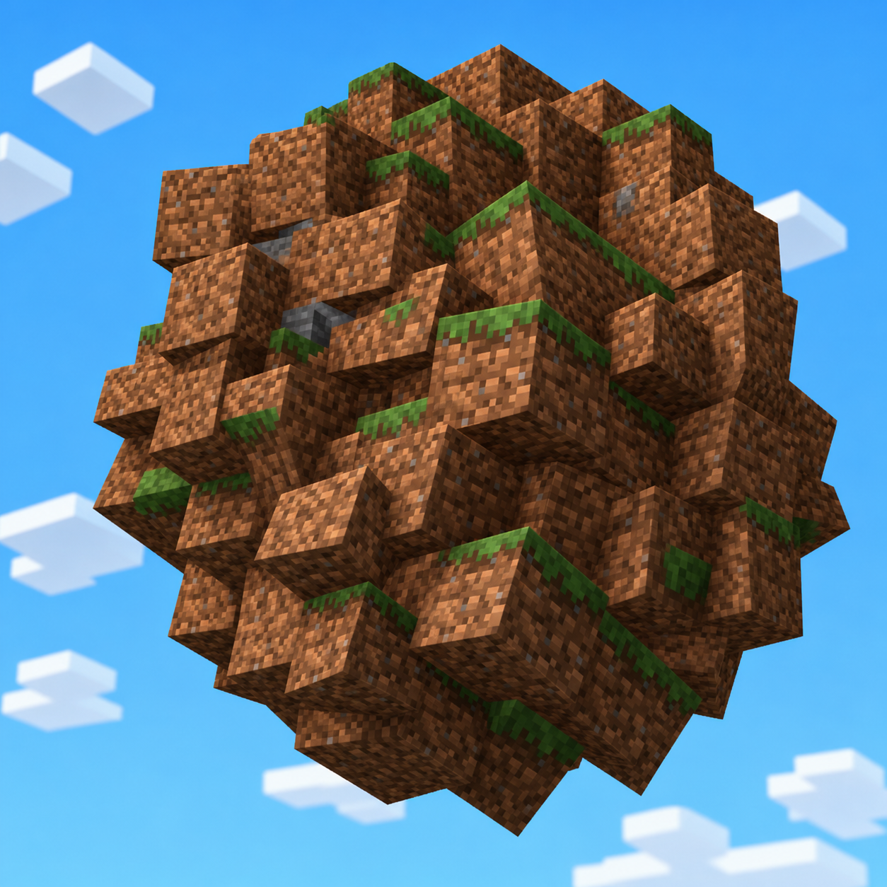

# KatamariIO



Roll around the world as a ball, rolling up terrain blocks, mobs, and other players to grow bigger and bigger.  
Supports **Fabric** and **Forge** on Minecraft **1.20.1**.

<iframe width="560" height="315" src="https://www.youtube-nocookie.com/embed/swtzWXad8Vc" title="YouTube video player" frameborder="0" allow="accelerometer; autoplay; clipboard-write; encrypted-media; gyroscope; picture-in-picture; web-share" allowfullscreen></iframe>

---

## Features

* **Rolling & Bouncing Physics**:
  * Transform into a rolling spherical player with smooth quaternion-based 3D rotation.
  * Immune to fall damage; bounce off the ground like a trampoline (configurable restitution coefficient).
* **Smooth Water Gliding & Dynamic Step-Up**:
  * Glide across water and lava surfaces without sinking or 20Hz vibration stutter.
  * Dive into water naturally by sneaking (Shift) or looking steeply downwards (> 50 degrees).
  * Step-up height (`maxUpStep`) dynamically scales with ball radius (minimum `1.25` blocks, up to `3.0`), climbing shores and terrain cliffs effortlessly without colliding.
* **Living Entity Attachment & 3D Tumble**:
  * Living mobs (cows, pigs, villagers, etc.) stick to the ball surface and rotate/flip synchronously with the sphere's rolling direction.
  * Safely release all attached mobs with restored AI, physics, and gravity when ball mode is toggled off, upon respawn, or via `/katamari resetBlocks`.
  * **Outward Pop-Out & 3-Second Cooldown**: Released mobs are popped outside the ball radius with an outward velocity impulse and granted a 3-second re-attachment immunity, preventing immediate re-absorption loops.
* **Ball-to-Ball Absorption (`attachBalls`)**:
  * Optional ball-versus-ball absorption: larger katamari players can pick up smaller katamari players on contact!
* **Interaction Reach Scaling**:
  * Block mining and placement reach automatically expands with ball radius (`size + 2.0`), allowing you to interact with the world no matter how gigantic you grow.
* **First-Person Clean View & Overhead Indicator**:
  * In first-person view, your own ball and attached blocks are hidden, keeping your crosshair and view completely unobstructed.
  * Third-person view automatically calculates collision-safe camera distance.
  * Multiplayer overhead billboard displays player face icon, golden indicator (▼), and name tag so huge katamaris can be identified at a distance.
* **Block & Entity Protection System**:
  * **Indestructible Protection**: Bedrock, barriers, end portal frames, and command blocks are protected by default as solid terrain obstacles.
  * **Tag Support (`#...`)**: Whitelist or blacklist blocks and entities using Minecraft tags (e.g. `#minecraft:leaves`, `#minecraft:logs`, `#minecraft:raiders`).
  * **Safety Guards**: Configurable protection for bosses (Wither, Ender Dragon, Warden), nametagged mobs, tamed pets, and players.
* **Fibonacci Spherical Grid Collision**:
  * Employs a golden-angle Fibonacci lattice (configurable, default `64` bins) across the sphere surface to track shell coverage with uniform area distribution and zero pole singularities.
  * Blocks and living mobs snap strictly to the current collision sphere surface ($R = \text{size} / 2$), completely eliminating protruding block clusters and keeping the visual ball and physics AABB synchronized.
* **High Performance & Networking**:
  * **Delta Synchronization**: Only sends newly collected blocks with periodic keyframes, drastically reducing multiplayer network traffic.
  * **VBO Mesh Baking**: Bakes collected blocks into cached VertexBuffer single-draw-call meshes for high FPS.
  * **Inner Shell Pruning**: Automatically prunes hidden inner blocks when the ball grows large to keep memory usage minimal.

---

## Presets

Quickly switch performance presets using `/katamari config preset <name>`:

| Preset | Description | `attachBlocks` | `attachEntities` | `maxRemovalsPerTick` | `pruneInnerBlocks` |
| :--- | :--- | :---: | :---: | :---: | :---: |
| **`fast`** | Maximum performance. Sphere grows without attaching blocks. | `false` | `false` | `24` | `true` |
| **`balanced`** | Recommended standard gameplay with attached blocks & pruning. | `true` | `false` | `48` | `true` |
| **`strict`** | Full simulation. Blocks + entities attach, no pruning, unlimited rate. | `true` | `true` | `-1` (unlimited) | `false` |

---

## Commands

Permission level: `2` (OP / Cheats enabled)

### Player Commands (`/katamari <subcommand>`)
Target-specific dynamic actions on players. If the value argument is omitted, the current setting of the target player(s) is queried:

* `/katamari size <targets> [value]`  
  Set or query collision and render diameter for target player(s) (Range: `0.01` to `100.0`).
* `/katamari restitution <targets> [value]`  
  Set or query bounce restitution coefficient (Range: `0.01` to `1.2`, default: `0.55`).
* `/katamari ball <targets> [true|false]`  
  Enable, disable, or query ball mode for player(s).
* `/katamari resetBlocks <targets>`  
  Clear attached blocks for target player(s).
* `/katamari resetEntities <targets>`  
  Safely release all attached living entities for target player(s).
* `/katamari resetAll <targets>`  
  Clear attached blocks, release all attached entities, and reset size to default (`1.5`).
* `/katamari help`  
  Show interactive command help and status overview.

### Server & World Configuration (`/katamari config <subcommand>`)
All server-wide and world configuration settings are cleanly grouped under `/katamari config`. Each option can be queried by omitting the value argument:

* `/katamari config get`  
  Display a full summary of all current server settings.
* `/katamari config reload`  
  Reload configuration from disk (`config/katamariio.json`).
* `/katamari config collisionBins [value]`  
  Set or query Fibonacci sphere collision bin count (Range: `16` to `512`, default: `64`).
* `/katamari config mode [blocks|entities|safe|face|full]`  
  Quickly switch operational modes (or query status):
  * `blocks`: Only blocks attach.
  * `entities`: Only living mobs attach without destroying blocks.
  * `safe` / `face`: Rolling & bouncing only with full terrain & mob protection.
  * `full`: Both blocks and entities attach.
* `/katamari config preset <fast|balanced|strict>`  
  Apply a predefined performance preset.
* `/katamari config attachBlocks [true|false]`  
  Toggle absorbing and breaking blocks (`true`: blocks attach, `false`: terrain protected).
* `/katamari config attachEntities [true|false]`  
  Toggle living mob attachment (Only mobs smaller than the katamari ball can attach).
* `/katamari config attachBalls [true|false]`  
  Toggle ball-to-ball attachment between katamari players (larger ball absorbs smaller ball).
* `/katamari config attachWhileRiding [true|false]`  
  Toggle whether blocks and entities attach while riding a vehicle or another entity (default: `false`).
* `/katamari config renderAttachedBlocks [true|false]`  
  Toggle rendering block models on the sphere surface.
* `/katamari config maxSize [value]`  
  Set or query maximum growth diameter limit (`-1.0` for unlimited).
* `/katamari config removalsPerTick [value]`  
  Set or query maximum block destruction rate per tick (`-1` for unlimited).
* `/katamari config maxAttachedEntities [value]`  
  Set or query maximum attached entities capacity limit (`-1` for unlimited, default: `-1`).
* `/katamari config prune [true|false]`  
  Toggle automatic hidden inner block pruning.
* `/katamari config indicator [true|false]`  
  Toggle multiplayer overhead face GUI indicator.
* `/katamari config disableFlyCheck [true|false]`  
  Toggle disabling server survival flight check when bounced high.
* `/katamari config protectPlayers [true|false]`  
  Protect players from being attached to katamaris.
* `/katamari config protectBosses [true|false]`  
  Protect boss mobs (Wither, Ender Dragon, Warden, Elder Guardian).
* `/katamari config protectNamed [true|false]`  
  Protect nametagged mobs.
* `/katamari config protectTamed [true|false]`  
  Protect tamed pets (wolves, cats, parrots, horses).
* `/katamari config protectIndestructible [true|false]`  
  Protect unbreakable blocks (bedrock, end portals, command blocks).

#### Attachment Filters (`/katamari config filter <...>`):
* `/katamari config filter block mode <none|blacklist|whitelist>`  
  Set block filter mode.
* `/katamari config filter block add <id_or_#tag>` / `remove <id_or_#tag>`  
  Add or remove a block ID or tag (e.g. `#minecraft:leaves`, `minecraft:obsidian`).
* `/katamari config filter block list` / `clear`  
  List or clear registered block filters.
* `/katamari config filter entity mode <none|blacklist|whitelist>`  
  Set entity filter mode.
* `/katamari config filter entity add <id_or_#tag>` / `remove <id_or_#tag>`  
  Add or remove an entity ID or tag (e.g. `#minecraft:raiders`, `minecraft:creeper`).
* `/katamari config filter entity list` / `clear`  
  List or clear registered entity filters.

---

## NBT Command Examples

Inspect and query player katamari state using vanilla `/data`:

```bash
# Check how many blocks are currently attached to the katamari
/data get entity @s SPM_BlockCount

# Check how many living entities are currently attached
/data get entity @s SPM_EntityCount

# Check total attached objects (blocks + entities)
/data get entity @s SPM_TotalCount

# Check current collision diameter
/data get entity @s SPM_Size

# Check current render diameter
/data get entity @s SPM_RenderSize

# Check if ball mode is currently active
/data get entity @s SPM_isBall

# Check current bounce restitution coefficient
/data get entity @s SPM_RESTITUTION
```

---

## Configuration File (`config/katamariio.json`)

The config file is located at `config/katamariio.json` and supports live reloading:

```json
{
  "attachBlocks": true,
  "attachEntities": false,
  "renderAttachedBlocks": true,
  "maxSize": -1.0,
  "maxRemovalsPerTick": 48,
  "pruneInnerBlocks": true,
  "showPlayerIndicator": true,
  "disableFlyCheck": true,
  "collisionBins": 64,
  "maxAttachedEntities": -1,
  "attachBalls": false,
  "attachWhileRiding": false,
  "blockFilterMode": "BLACKLIST",
  "blockFilterList": [
    "minecraft:bedrock",
    "minecraft:barrier",
    "minecraft:end_portal_frame",
    "minecraft:command_block",
    "minecraft:chain_command_block",
    "minecraft:repeating_command_block",
    "minecraft:structure_block",
    "minecraft:jigsaw"
  ],
  "protectIndestructibleBlocks": true,
  "entityFilterMode": "BLACKLIST",
  "entityFilterList": [],
  "protectBosses": true,
  "protectNamedEntities": true,
  "protectTamedEntities": true,
  "protectPlayers": true
}
```

---

## License

This project is licensed under the [MIT License](LICENSE).
